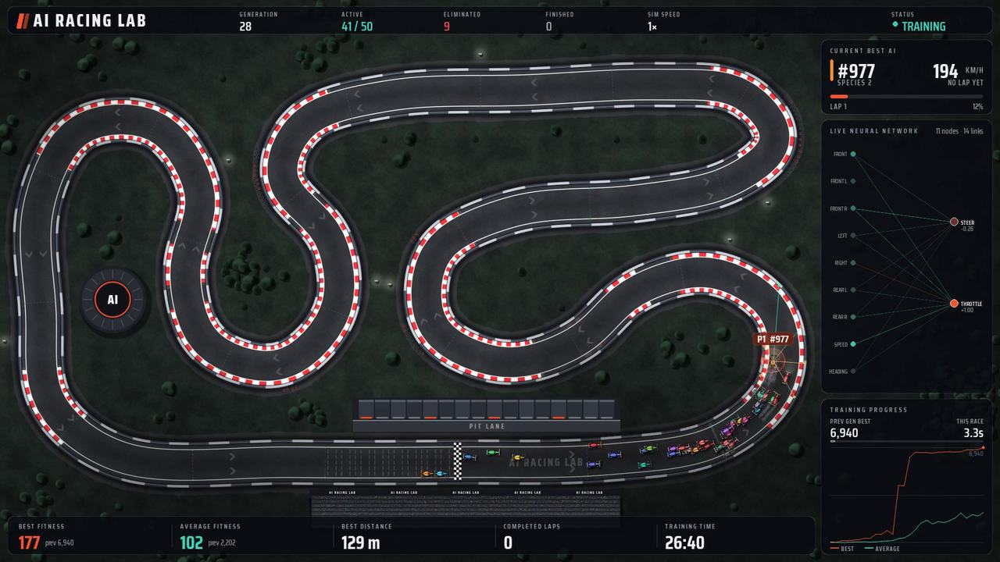
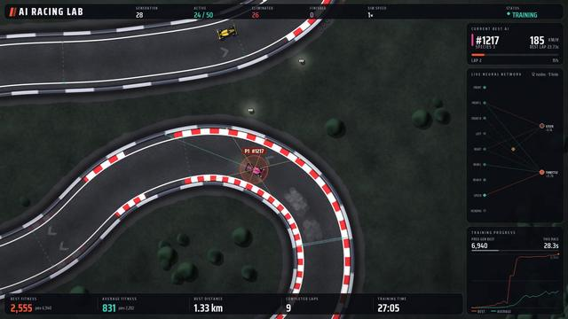
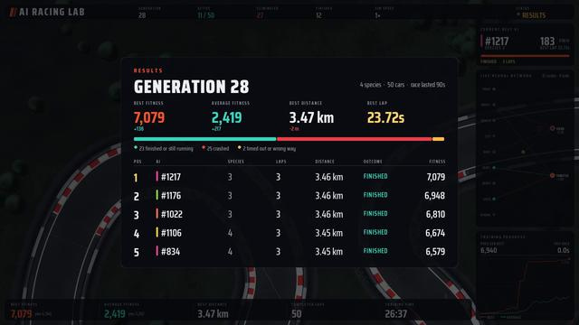
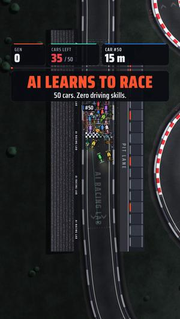
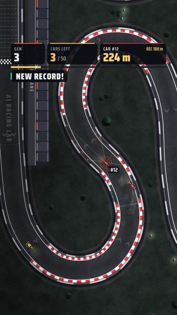
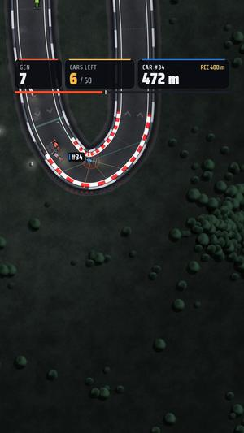
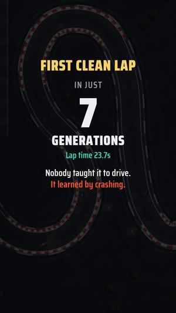
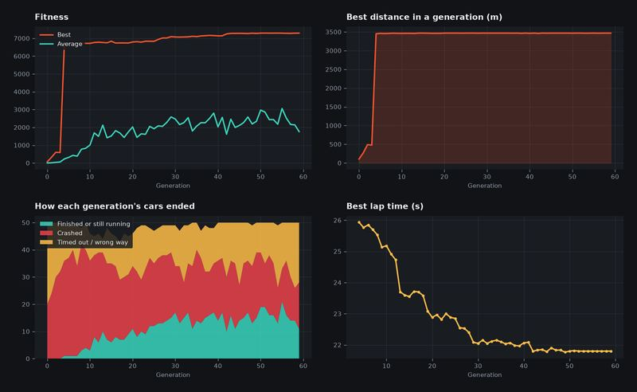

<h1 align="center">🏎️ Self-Learning Racing Cars</h1>

<p align="center">
  <b>50 cars. Zero driving skills. No rules programmed.</b><br>
  Watch neural networks teach themselves to race, one crash at a time.
</p>

<p align="center">
  
</p>

**Came from the Reel? This is the code.** Follow the three steps below and run it on your own computer.

## 🚀 Quick start

**You need [Python](https://www.python.org/downloads/) 3.12 or 3.13.** Other versions won't install, including 3.14. No graphics card needed.

**1. Download the code**

```bash
git clone https://github.com/Mady93823/self-learning-racing-cars.git
cd self-learning-racing-cars
```

No Git? Click the green **Code** button above, choose **Download ZIP**, unzip it, and open a terminal in that folder.

**2. Install and run**

<table>
<tr><th>🪟 Windows</th><th>🍎 Mac / 🐧 Linux</th></tr>
<tr><td>

```bat
py -3.12 -m venv .venv
.venv\Scripts\python -m pip install -r requirements.txt
.venv\Scripts\python main.py
```

</td><td>

```bash
python3 -m venv .venv
.venv/bin/python -m pip install -r requirements.txt
.venv/bin/python main.py
```

</td></tr>
</table>

**3. Press `ENTER` and watch.** The first launch paints the circuit, which can take up to a minute. After that it opens quickly.

> The cars will be terrible at first. That's the point! In our test runs, they finished their first full race between generation 4 and generation 24. Press `F` to speed things up.

## 🎮 Things to try

In the commands below, `python` means the one from step 2: `.venv\Scripts\python` on Windows, or `.venv/bin/python` on Mac and Linux.

| I want to... | Run this |
|---|---|
| Watch cars learn from nothing | `python main.py` |
| See a fully trained car right now | `python main.py evaluate` |
| Train as fast as possible, no graphics | `python main.py train --headless --generations 60` |
| Continue my last training run | `python main.py train --resume` |
| Race with 100 cars | `python main.py --population 100` |
| Make my own vertical Reel | `python main.py reels` |
| Record a widescreen video | `python main.py record --generations 12` |

**Controls while it's running**

| Key | Action | Key | Action |
|---|---|---|---|
| `SPACE` | Pause | `V` | Sensor rays on/off |
| `F` | Fast-forward | `H` | Dashboard on/off |
| `S` | Slow motion | `P` | Screenshot |
| `C` | Change camera | `R` | Restart training |
| `F11` | Fullscreen | `ESC` | Quit |

## 📸 Gallery

<table>
<tr>
<td></td>
<td></td>
</tr>
<tr>
<td align="center">Follow the best car and see its sensors</td>
<td align="center">Results after every generation</td>
</tr>
</table>

**Make your own Reels:** one command renders a finished vertical video, from random brains to the first clean lap.

<table>
<tr>
<td></td>
<td></td>
<td></td>
<td></td>
</tr>
</table>

The learning is real. Here's one full training run, with the best lap time dropping as generations pass:

<p align="center"></p>

## 🧠 How it works

Every car has its own small neural network and starts out completely random.

1. **It senses.** Seven distance sensors measure the barriers, plus the car's speed and its heading relative to the track.
2. **It decides.** The network turns those 9 numbers into steering and throttle. Nothing about driving is hardcoded.
3. **It's scored.** Going further and faster earns points. Crashing, reversing, standing still and spinning lose them.
4. **It evolves.** The best networks breed and mutate using [NEAT](https://github.com/CodeReclaimer/neat-python), and the next generation tries again.

## 🛠️ Having trouble?

| Problem | Fix |
|---|---|
| `No matching distribution found` or pygame fails to install | Your Python version isn't supported. Install 3.12 or 3.13, then delete the `.venv` folder and repeat step 2. Check with `python --version`. |
| Windows: `py` isn't recognised | Reinstall Python from python.org with the "Add to PATH" and launcher options ticked. |
| Windows: `py -3.12` can't find Python | You have another version. If it's 3.13, use `py -3.13`. |
| Linux: `ensurepip is not available` | Run `sudo apt install python3-venv` and try again. |
| It looks frozen on launch | The first launch paints the circuit, so give it up to a minute. |
| The text looks small | Press `F11` for fullscreen, or set a size with `--window 1280x720`. |
| It runs slowly | Use the full-track camera (`C`), hide rays (`V`), or train with `--headless`. |
| Cars aren't improving | Give it more generations, or try another run with `--seed 7`. |

> **Tested on Ubuntu 24.04.** Windows and macOS are supported by the libraries used, but haven't been tested yet.

<details>
<summary><b>🎬 More about making videos</b></summary>

`python main.py reels` renders a 1080×1920, 30 fps MP4 to `recordings/` with no window needed. It can take several minutes. Add your sound inside Instagram, because the video's audio track is silent.

| Option | Effect |
|---|---|
| `--seed 46440` | Film one exact run again |
| `--story 5-9` | Which generation the first lap should arrive in |
| `--max-seconds 170` | End the video by this length |
| `--population 100` | A bigger swarm |
| `--preview` | Show a window while rendering |

Every generation in a Reel is real training. Reels are edited, though: seeds are compared off camera to pick a watchable run, each attempt follows the car that gets furthest, and attempts may cut away once that's over. Playback speed varies, and the screen labels it whenever it isn't real time.

For widescreen video, `python main.py record --generations 40 --show-every 8` trains 40 generations and shows every 8th. Add `--resume` to start from your latest checkpoint.

</details>

<details>
<summary><b>⚙️ Fitness, settings and project layout</b></summary>

**Fitness**

| Rewarded | Penalised |
|---|---|
| New ground: 1000 per lap | Crash: 20, plus 15% of points earned |
| New checkpoint: 10 (24 per lap) | Timed out for inactivity: 30 |
| Completed lap: 500 | Going the wrong way: 60 |
| Finishing the race: 250 | Driving backwards: 500 per lap's worth |
| Pace: up to 600 per lap | Standing still: 10 per second |
| Smooth steering: up to 150 per lap | Re-crossing a checkpoint: 25, spinning: 15 per radian |

Only new ground scores, so driving in circles or back and forth earns nothing. The tests in `tests/` check these exploits.

**Settings:** every tunable value is in `settings.py`, and NEAT's are in `config/neat-config.txt`. To override without editing code, use `--settings my.json`:

```json
{"training": {"generation_seconds": 60}, "fitness": {"crash_fraction": 0.2}}
```

**Your data:** the best AI is saved to `models/best_genome.pkl`, checkpoints to `models/checkpoints/`, and charts and history to `results/`. Models and checkpoints are Python pickle files, so only load ones from people you trust.

**Layout**

```
main.py        Commands: train, evaluate, record, reels
settings.py    Every tunable value
simulation/    The race: track, physics, collisions, laps
ai/            Sensors, networks, fitness, evolution
rendering/     Circuit, cars, camera, particles
ui/            App loop, dashboard, Reels layout, recorder
tests/         Run with: python -m unittest discover -s tests
```

</details>

---

Built with [pygame](https://www.pygame.org/), [neat-python](https://github.com/CodeReclaimer/neat-python), [NumPy](https://numpy.org/) and [Matplotlib](https://matplotlib.org/). Interface font: [Saira Condensed](https://fonts.google.com/specimen/Saira+Condensed) (SIL Open Font License, see `assets/fonts/OFL.txt`).

⭐ If you enjoyed this, star the repo and share the Reel!
